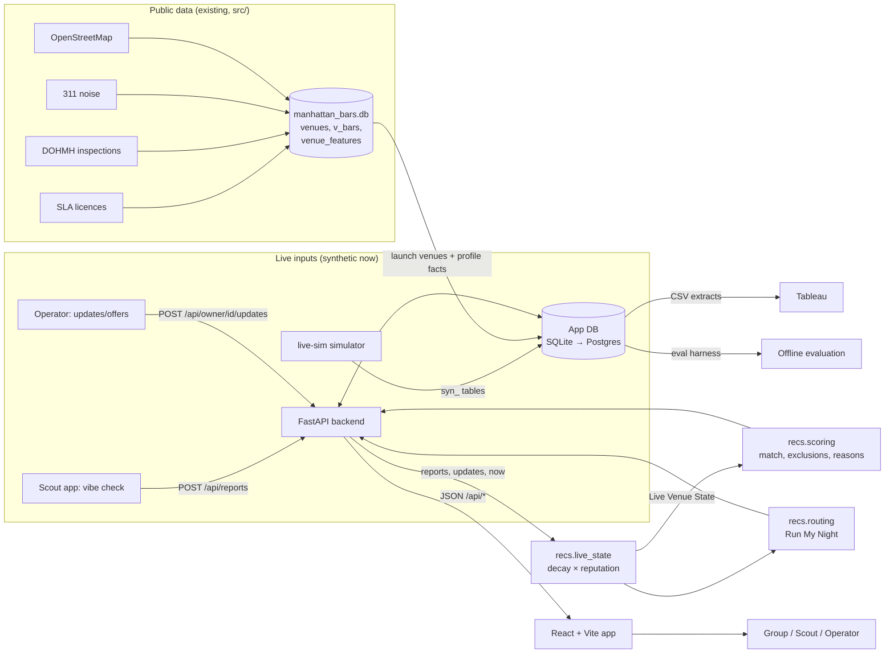

# PRD — specs workstream (Nightlife Autopilot)

Status: planning draft, 2026-11-11. Owner: Ryan Mehta. Workstream: `specs`.
Branch: `nightlife/specs` (from `nightlife/contracts`). Built against
`docs/CONTRACTS.md` **v2 → v2.2 + §J** (through commit b46d75f); nothing here
overrides it. All change requests are resolved in v2 (see §13). The constants
in §5–7 are canonical per v2 §A.

Numbers marked **(placeholder)** are first guesses chosen to be reasonable for
the LES pilot. They are tuning knobs, not findings. Contracts v2 §A makes the specs values canonical
across workstreams. The build phase puts every
one of them in a single table (`docs/specs/PARAMETERS.md`) so ml-recs and
backend read them from one place.

---

## 1. Problem

A group standing on Ludlow St at 22:30 wants to know where to go *now*. Today
they piece it together from Instagram stories, Google "popular times" (a
historical average, not tonight), group-chat guesses and walking past windows.
None of these says whether there is dancing, how long the line is, what the
cover is or whether the music suits the group, and none says how fresh or how
trustworthy the information is.

What we have: a public-data pipeline (`data/manhattan_bars.db`, 5,737 venues,
1,727 in `v_bars`) with licences, inspections, 311 noise counts and OSM tags,
and a launch list of 35 LES venues (`data/launch_venues.csv`; note all 35 are
`Bar/Tavern`, none are `Club`). What we lack: any live signal, users, backend,
frontend or deployment. The complaint-risk model (ROC AUC ≈ 0.72) predicts 311
complaint risk, which is **not** nightlife quality and must never be presented
as such.

The specs workstream turns the product idea into a single, exact, testable
definition that the build workstreams (live-sim, ml-recs, backend, frontend)
implement against, so the Nov 17 integration works the first time.

## 2. Goals and non-goals

### Goals (for the specs workstream)
1. One architecture doc with a diagram, components, data flow, environments
   and stack, agreed by backend/frontend/ml-recs.
2. User stories with acceptance criteria for every MVP and later feature.
3. Exact formulas for freshness, reputation weighting, vibe, confidence
   (+ display threshold), match, hard-limit exclusions, missing data and
   trend, plus golden test vectors that ml-recs must reproduce.
4. Scout trust rules: reputation, anti-gaming, disputes, bounties, points,
   levels.
5. A pilot success-metric set and an offline evaluation plan that runs on
   live-sim data before any real users exist.
6. Team workflow: PR template, CONTRIBUTING guide and a list of good first PRs
   so every team member lands one merged PR (course requirement).

### Non-goals
- Writing application code (that is ml-recs/backend/frontend). Specs only
  ships docs, golden test fixtures and a tiny stdlib checker for them.
- Payments, ticketing, table booking, reservations.
- Areas beyond zip 10002 for the pilot (the DB covers Manhattan, but scoring
  is tuned for 35 launch venues).
- Real user identity, social graph or messaging. MVP auth is simple (backend
  decides; see §8 dependency).
- Using complaint risk as a quality or "vibe" signal.

## 3. Users

| Persona | Need | Primary surfaces |
|---|---|---|
| **Group planner** (consumer, 21–30, group of 2–6) | "Where should we go in the next 15 minutes?" | onboarding prefs, Tonight pick, venue cards/search/filters, profile, map |
| **Group member** | sees the pick and the reasons; may veto | shared pick (later), venue profile |
| **Scout** | quick, rewarded 10-second vibe check; status | Scout mode, leaderboard, bounties |
| **Venue operator** | accurate profile, post cover/DJ/offers, see demand | owner dashboard, update form |
| **Admin / moderator** (team member) | resolve disputes, ban gamers | admin endpoints (later), DB scripts in MVP |

Assumption A1: the class demo users are team members and classmates; the
"pilot" is a synthetic pilot driven by live-sim (§10), with an optional small
real pilot later.

## 4. System architecture

### 4.1 Diagram



### 4.2 Components

| Component | Owner | Responsibility |
|---|---|---|
| Public-data pipeline | existing (`src/`) | builds `manhattan_bars.db`; read-only for everyone else |
| live-sim | live-sim | generates all `syn_` tables over Thu–Sat nights; replay via `now=` |
| `recs` package | ml-recs | `live_state.compute[_all]`, `scoring.recommend`, `routing.plan_night`, crowd model, clustering |
| Backend API | backend | endpoints in CONTRACTS.md; persistence; validation of reports (rate limits, geofence, status); points ledger |
| Frontend | frontend | screens, mock-API mode, "demo data" badge |
| Analytics | tableau | extracts + dashboard |
| Evaluation harness | ml-recs (code), specs (definition) | offline metrics in §10 |

### 4.3 Data flow (one request)

1. Public DB → backend seeds `venues` for the 35 launch venues (from
   `data/launch_venues_full.csv`, made by integration: name, address, lat/lon,
   OSM hours, complaint count) plus `syn_venue_attributes` (with `is_claimed`,
   `opening_hours`). Synthetic tables live in `data/live_sim.db` (seed 42, not
   committed); backend attaches both DBs. Real twins without the `syn_` prefix
   are read with `UNION ALL`; `INCLUDE_SYNTHETIC=0` hides synthetic rows.
2. Scout reports and operator updates arrive (synthetic rows from live-sim, or
   live POSTs). Backend stores them with `status` (§7.4).
3. On read, backend loads reports/updates with `ts ∈ [now − 180 min, now]`,
   joins scout reputation, and calls `live_state.compute_all(reports, updates, now)`.
   Live state is computed per request and never stored as truth (contract).
   A 60 s in-memory cache keyed by (`now` rounded to the minute) is allowed.
4. `/api/recommend` passes Preferences + states + venues to `scoring.recommend`,
   which returns sorted Recommendation results (non-excluded first).
5. Frontend renders scores, reasons, missing info and the demo-data badge.

### 4.4 Environments

| Env | Backend | DB | Frontend | Data |
|---|---|---|---|---|
| local | `uvicorn` on :8000 | SQLite file `backend/app.db` | `vite` on :5173, or mock-API mode | syn_ seeded, `now=` replay |
| preview | Render (free web service) per branch, optional | SQLite on disk (ephemeral) | Vercel preview per PR | seeded on boot |
| demo/prod | Render web service | Postgres (Render) or SQLite-on-disk fallback (placeholder; backend decides) | Vercel production | seeded demo night; `DEMO_NOW` default |

Env vars (reserved in v2 §H): `INCLUDE_SYNTHETIC`, `DEMO_NOW`, `CORS_ORIGINS`,
`DATABASE_URL`, `LIVE_SIM_DB`, `FEATURE_ROUTING`, `FEATURE_HEATMAP`,
`VITE_API_BASE`, `VITE_API_MODE` (mock|live), `VITE_DEMO_NOW`,
`VITE_FEATURE_ROUTING`, `VITE_FEATURE_HEATMAP`.

Demo time: **`DEMO_NOW = 2026-11-14T23:30:00-05:00`** (Sat). Frontend
forwards `VITE_DEMO_NOW` / `?now=` as API `now=`.

### 4.5 Stack choice
FastAPI + Pydantic v2 + SQLAlchemy 2 (SQLite now, Postgres-ready), Python 3.12;
React + Vite + TypeScript; Render (API) + Vercel (web). Rationale: Python keeps
the `recs` package and the existing pipeline in one language; SQLite needs no
account for local work; SQLAlchemy keeps the Postgres move to a connection
string; Vite/Vercel/Render all have free tiers and git-push deploys.

## 5. Scoring specification (source of truth after build: `docs/specs/SCORING.md`)

Notation: `now` is the request time (or `now=` replay time). `age_i` = minutes
between report *i*'s `ts` and `now`. All weights below are per report and per
field.

### 5.1 Eligibility of inputs
- Scout reports with `status ∈ {accepted, pending}` count; `flagged`,
  `removed` count 0; `disputed` counts at half weight (§7.4). `status` is a
  v2 column on `syn_scout_reports`; if a row lacks it, treat it as `accepted`.
- Report rows passed to `recs` carry `reputation` (backend joins it; default 0.5).
- Ignore any input with `ts > now + 2 min` (clock skew) or `age > 180 min`
  (cutoff = 6 half-lives).
- Operator updates (`syn_venue_updates`) may supply **cover, genres, dj,
  event, offer** only. They never supply crowd, dancing or line (an operator
  self-reporting crowd is a conflict of interest).

### 5.2 Freshness decay
`w_time_i = 0.5 ^ (age_i / H_field)`

| Field | Half-life H (placeholder) | Why |
|---|---|---|
| crowd, dancing, line_minutes | 30 min | energy changes fast |
| cover_usd, music_genre (scout) | 60 min | changes a few times a night |
| operator cover/genres/dj | 120 min | posted intentionally; event-scoped |
| operator offer | valid until `offer_expires_at`, else 120 min | |

`freshness_minutes` = age of the most recent input that contributed any
weight to the state (rounded down). `null` if none.

### 5.3 Reputation and source weighting
- Scout reputation `r ∈ [0, 1]`, new scouts 0.5. The live app uses current
  `syn_scouts.reputation`. Models and evaluation replaying past nights must use
  `syn_scout_reputation_history` **as of the report date** (joining final
  reputation to past reports leaks the future; v2.1).
- `w_rep = 0.25 + 0.75·r` (a 0-reputation scout still counts a little; a 1.0
  scout counts 4×).
- `w_ver = 1.0` if `verified_presence = 1`, else `0.6`.
- `w_status = 1.0` (accepted/pending), `0.5` (disputed), `0` (flagged/removed).
- Operator updates: `w_src = 0.8` (placeholder) and `w_rep = 1`.
- Total: `w_i = w_time_i · w_rep_i · w_ver_i · w_status_i` (scout) or
  `w_time_i · w_src` (operator).

### 5.4 Field estimates (Live Venue State fields)
Using only inputs where the field is non-null:
- `crowd` = weighted mean (1–5), 1 decimal.
- `dancing` = weighted mean (0–2), 1 decimal.
- `line_minutes` = weighted median, integer (robust to one "60 min" troll).
- `cover_usd` = weighted median over scout + operator values, integer.
- `music_genres` = weighted vote; include each genre whose weight share ≥ 0.30
  (placeholder), sorted by share; `[]` if field has inputs but none clears,
  `null` if no inputs.
- A field whose total weight `W_f < 0.30` (placeholder) is `null` (too thin to
  state). Missing stays `null`; never fill with a default.
- `n_reports` = count of scout reports with `w_i > 0`.
- `sources` = distinct of `"scout"`, `"venue_update"` that contributed.

### 5.5 Vibe score (0–100, current energy, not quality)
```
crowd_n = (crowd − 1) / 4
dance_n = dancing / 2
line_n  = min(line_minutes, 30) / 30
vibe    = round(100 · Σ a_k·x_k / Σ a_k)  over available k
a = {crowd: 0.50, dance: 0.35, line: 0.15}   (placeholder)
```
- `crowd` null → `vibe_score = null` (crowd is the anchor).
- `dancing` or `line` null → drop that term and renormalise (no favourable
  fill); the missing field is listed in recommendation `missing` and confidence
  takes the hit via 5.6.

### 5.6 Confidence (0–1, separate from vibe)
```
W        = Σ w_i over scout reports with crowd non-null
support  = 1 − exp(−W / k),           k = 1.5            (placeholder)
sd_w     = weighted std-dev of crowd
agree    = 1 − 0.5 · min(1, sd_w / 1.5)
diverse  = 1.0 if ≥ 2 distinct scouts, else 0.6
conf     = round(support · agree · diverse, 2)
```
If only operator updates exist: `conf = min(0.25, 0.25 · Σ w_i)`, and
`vibe_score = null`.

**Display threshold** (frontend):

| conf | Display |
|---|---|
| ≥ 0.40 | vibe number + "N reports, M min ago" |
| 0.20 – 0.39 | vibe shown greyed with "low confidence" label |
| < 0.20 or vibe null | "No fresh reports" + CTA "Be the Scout" (bounty) |

- **Vibe label bands** (v2.2 §J): 0–34 "Chill", 35–64 "Lively", 65–100
  "Packed"; vibe null → no label. G1 (vibe 65) is "Packed".
- **Stale tag** (v2.2 §J): `freshness_minutes > 60` shows a "stale" tag even
  when confidence ≥ 0.40. Inputs older than 180 min are ignored entirely (§5.1).

### 5.7 Trend
Compute weighted crowd over two windows: recent `[now−30, now]` and prior
`[now−90, now−30)` (each with its own weights, same decay).
- either window `W < 0.5` → `trend = null`
- `Δ = crowd_recent − crowd_prior`; `Δ ≥ +0.4` → `"rising"`, `Δ ≤ −0.4` →
  `"falling"`, else `"steady"` (placeholders).

### 5.8 Worked example (golden vector G1)
4 reports from 4 scouts, each `r = 0.8`, verified, ages 5/12/20/40 min,
crowd 4/4/3/4, dancing 2/1/1/2, line 10/15/10/5.
- `w_rep = 0.85`; weights = 0.7573, 0.6442, 0.5355, 0.3373; `W = 2.2742`
- crowd = 3.76 → 3.8; dancing = 1.48 → 1.5; line (weighted median) = 10
- vibe = 100·(0.5·0.691 + 0.35·0.741 + 0.15·0.333) = **65**
- support = 0.7804, sd_w = 0.424, agree = 0.8586, diverse = 1 → **conf 0.67**
ml-recs tests must reproduce G1–G8 (OUTLINE §5) within ±1 vibe point and
±0.01 confidence.

### 5.9 Hard-limit exclusions
A venue is `excluded = true` when a **known** value breaks a limit:
| Rule | Known means |
|---|---|
| `cover_usd > max_cover_usd` | cover field non-null (scout or operator) |
| `line_minutes > max_line_minutes` | line field non-null |
| `distance_km > max_distance_km` | always known (haversine from prefs lat/lon) |
| closed now | OSM `opening_hours` parses and says closed; unknown hours never exclude |
| not a launch venue when `launch_only=true` | always known |

Unknown values never exclude; they go in `missing` (e.g. `"cover not reported
tonight"`). Excluded venues are returned after all non-excluded ones, with the
reason in `excluded_reason` (v2 §F, e.g. `"cover $25 over your $20"`;
`null` when not excluded), so the frontend can show "N hidden by your limits".

### 5.10 Match score (0–100, fit to this group)
Each component `s_k ∈ [0,1]`; unknown inputs score **0.4** (below neutral, so
confirmed info beats no info) and add a `missing` entry.

| k | Weight (placeholder) | Score |
|---|---|---|
| genre | 0.25 | 1.0 live genre ∈ prefs.genres; 0.6 only static `syn_venue_attributes.genres` overlap; 0.0 known, no overlap; 0.4 unknown; 1.0 if prefs.genres empty |
| dancing | 0.20 | `want_dancing=true`: dancing/2; `false`: 1 − dancing/2; prefs null: weight 0 |
| crowd | 0.15 | 1 − \|crowd − crowd_pref\| / 4 |
| line | 0.10 | 1 − 0.5·line/max_line (within limit) |
| cover | 0.10 | 1 − 0.5·cover/max_cover; 1.0 if cover = 0 |
| distance | 0.15 | 1 − distance/max_distance |
| group | 0.05 | min(1, capacity / (10·group_size)); capacity from syn_venue_attributes |

`match_score = round(100 · Σ w_k s_k / Σ w_k)` (renormalise if a weight is 0).

**Ranking:** `rank_score = match_score · (0.75 + 0.25·confidence)` so a strong
match backed by fresh reports outranks a strong match on thin data. Ties →
smaller distance. `rank_score` and `rank` (1-based) are returned fields (v2 §F).

Worked example (G5): Preferences from CONTRACTS.md, venue = G1 state, live
genre hip-hop, cover 15, distance 0.4 km, capacity 120 → components
1.0/0.741/0.941/0.667/0.625/0.733/1.0 → **match 83**, rank_score 76.

### 5.11 Reasons and missing
- `reasons`: up to 3, the top positive weighted components, templated with
  evidence: `"Hip-hop playing (2 reports, 12 min ago)"`, `"Line ~10 min,
  under your 15"`, `"Dancing reported (3 reports)"`, `"0.4 km away"`.
- `missing`: one entry per null field the prefs care about: `"cover not
  reported tonight"`, `"no dancing reports"`, `"music unknown"`, `"no fresh
  reports — scores are low confidence"`.
- Complaint risk is returned as the separate `complaint_risk` field, labelled
  "311 noise-complaint risk" (v2 §F/§G). It never feeds vibe, match, rank or
  reasons.

### 5.12 Run My Night (later)
`routing.plan_night`: greedy, n_stops (default 3), 60 min per stop
(placeholder), walking 4.5 km/h, uses predicted state at arrival time (crowd
model if available, else current state with decay), objective = Σ rank_score
− 10·walk_km, no repeat venues, each stop must pass hard limits at its arrival
time. ml-recs may replace greedy with a small orienteering solver; output
shape unchanged.

## 6. Feature requirements and user stories

IDs: `US-<area>-<n>`. MVP unless marked **Later**. "Given/When/Then" are the
acceptance criteria the frontend/backend tests check.

### 6.1 Onboarding and preferences
- **US-ON-1** As a planner I set genres, dancing yes/no, crowd level, max
  cover, max line, max distance, group size in ≤ 30 s.
  - Given first launch, when I finish onboarding, then a Preferences object
    matching CONTRACTS.md is stored locally and sent with `/api/recommend`.
  - Defaults: no genres, want_dancing null, crowd_pref 3, max_cover 30,
    max_line 20, max_distance 1.5, group 2 (placeholders). Location from
    browser geolocation; fallback to Delancey/Essex (40.7185, −73.9878).
- **US-ON-2** I can edit limits later from the filter bar without redoing
  onboarding.

### 6.2 Tonight pick
- **US-TP-1** As a planner I see one top pick plus 2 alternates with match,
  vibe, confidence, distance, reasons and missing.
  - Then the list order equals `/api/recommend` order; excluded venues are not
    in the top 3; the count of excluded venues is shown.
- **US-TP-2** Each score shows freshness ("12 min ago") and the confidence
  display rule in §5.6.
- **US-TP-3** Every screen with syn_ data shows the "demo data" badge.

### 6.3 Venue cards, filters, search
- **US-VC-1** Cards show name, style, distance, vibe (per display rule),
  trend arrow, line/cover if known.
- **US-VC-2** Filters: style, genre, open now, "has fresh reports"
  (conf ≥ 0.4), launch only. Maps to `/api/venues` params.
- **US-VC-3** Search by name substring, case-insensitive, ≥ 2 chars,
  results ≤ 300 ms on local.
- Acceptance: an empty result shows "No venues match — loosen filters".

### 6.4 Venue profile
- **US-VP-1** Profile shows public facts (address, hours if known, inspection
  grade, 311 count labelled "complaint risk, not quality"), live state, last
  5 reports (age, crowd, dancing, line, scout level — no scout identity
  beyond display name), current offers.
- **US-VP-2** Operator-claimed profile shows a "claimed" check.

### 6.5 Scout mode (10-second vibe check)
- **US-SC-1** As a Scout I submit crowd (1–5 slider), dancing (none/some/lots),
  line (0/5/10/20/30+ chips), optional cover and genre, in ≤ 10 s / ≤ 4 taps
  for required fields.
  - `POST /api/reports` (Bearer token from `POST /api/auth/demo-login`)
    returns 201 with `{report_id, ts, status, points_pending}`; server sets
    `scout_id`, `verified_presence`, `distance_m`.
- **US-SC-2** Rate limits enforced server-side: 1 report per venue per scout
  per 20 min; 6 reports per scout per hour (placeholders) → 429 with a
  friendly message.
- **US-SC-3** If GPS is allowed and within 150 m of the venue,
  `verified_presence = 1`; we store only distance in metres, not raw location.
- **US-SC-4** After submitting I see points pending and my new rank.

### 6.6 Rewards, leaderboard, bounties
- **US-RW-1** Leaderboard: top 20 by points this week and all-time; display
  name, level, reports, reputation band (not the raw number).
- **US-RW-2** Bounties list open bounties with `venue_name`, points,
  `expires_at`; claimed implicitly by the first qualifying (verified, not
  flagged) report before expiry — no claim endpoint in MVP (v2 §E).
- **US-RW-3** Points become "earned" after a 30-min hold if the report is not
  flagged.

### 6.7 Owner dashboard
- **US-OW-1** As an operator I see views, card taps, report count and a
  demand-by-hour chart for my venue, aggregated from `syn_venue_events`
  (synthetic for now, badged).
- **US-OW-2** I post an update (cover, DJ, genres, event, offer + expiry);
  it appears in live state within 1 min and on the profile as "posted by venue".
- **US-OW-3** I can dispute a scout report (reason required); I cannot submit
  scout reports for my own venue (403).
- **US-OW-4** Claiming: MVP = `is_claimed=1` in `syn_venue_attributes`; owner
  logs in via demo-login with `role=owner, venue_id` (no verification flow). **Later:** phone/email-domain verification.

### 6.8 Later features
- **US-HM-1 (Later) Availability heatmap**: map of launch venues coloured by
  vibe, opacity by confidence, from `/api/heatmap`; `now=` slider replays the
  night.
- **US-CP-1 (Later) Compatibility score**: per-member prefs merged into a group
  score = mean of member match scores − 0.5·std (placeholder); any member's
  hard limit excludes.
- **US-RL-1 (Later) Recommendation list**: full ranked list with "why not"
  for excluded venues.
- **US-RN-1 (Later) Run My Night**: 3 stops with times and walking minutes,
  each stop passes limits at arrival, from `/api/plan-night`.

### 6.9 Non-functional
- p95 `/api/recommend` ≤ 500 ms for 35 venues and 2k reports (placeholder).
- Mobile-first, works at 360 px width.
- No PII beyond display names; no raw GPS stored.
- 21+ notice on first launch (product is about bars).
- Every synthetic dataset follows the CONTRACTS synthetic-data rule.

## 7. Scout trust, anti-gaming, disputes, bounties, rewards

### 7.1 Reputation update
Start `r = 0.5`. When a report gets a **consensus** (≥ 2 other accepted reports
from other scouts at the same venue within ±20 min):
`a = 1 − |crowd − consensus_crowd| / 4`; `r ← clip(r + 0.05·(a − 0.7), 0.05, 0.98)`.
Verified presence on the report: extra `+0.005`. Dispute upheld: `−0.10`.
Reputation never changes on reports without consensus.

### 7.2 Points and levels
| Event | Points (placeholder) |
|---|---|
| accepted report | +10 |
| verified presence | +5 |
| first report at that venue tonight (after 20:00) | +5 |
| bounty claimed | +bounty.points |
| report flagged or dispute upheld | clawback of that report's points, −10 |

Levels by all-time points: Rookie 0, Regular 100, Insider 500, Legend 1500.
Levels are cosmetic; reputation, not level, drives weight.

### 7.3 Anti-gaming checks (backend at write time, ml-recs at read time)
1. Rate limits (US-SC-2).
2. Owner accounts cannot report their own venue.
3. Velocity: two reports by the same scout implying > 15 km/h between venues
   → second report `flagged`.
4. Outlier: with ≥ 3 other reports in ±20 min, `|crowd − consensus| ≥ 2.5`
   → `flagged` (weight 0) pending review.
5. Brand-new scouts (< 3 reports) count at `r = 0.5` regardless; reputation
   cannot be bought with volume because weight is capped by `w_rep ≤ 1`.
6. Bounty farming: a bounty pays only if the report is verified and not
   flagged after the 30-min hold.
live-sim assigns scout archetypes in `syn_scout_truth` (honest | casual |
sloppy | gamer | shill); gamers (always crowd 5) and shills (always one
`home_venue_id`) let the evaluation (§10) measure how much these checks
protect scores. The app never reads `syn_scout_truth`.

### 7.4 Report status and disputes
`pending → accepted` after the 30-min hold; `pending|accepted → flagged`
(automatic); any → `disputed` (owner/user dispute); moderator resolves
`disputed → accepted` (rejected dispute) or `→ removed` (upheld). Disputed
reports weigh 0.5 until resolved. Disputes older than 48 h auto-reject.
MVP moderation = a team member runs a script / admin endpoint.

### 7.5 Bounties
Auto-created every 15 min between 21:00 and 02:00 Thu–Sat for any launch
venue with `confidence < 0.30` and no open bounty: `points = 20 + 10·min(3,
floor(freshness_minutes/30))` (null freshness → 50), expires after 60 min,
`reason = "no fresh reports"` or `"conflicting reports"` (agree < 0.6).
Max 8 open bounties at once (placeholder).

## 8. Dependencies on other workstreams

| Workstream | Specs gives | Specs needs |
|---|---|---|
| **specs** (self) | — | — |
| **research** | personas + stories to validate | interview findings to confirm/adjust weights, display threshold, defaults (by Nov 14 if any) |
| **tableau** | metric definitions (coverage, freshness) | none blocking |
| **live-sim** | rules for gamer/shill scouts, report cadence assumptions | `syn_true_state` (15-min truth) and `syn_scout_truth` (archetypes), eval-only |
| **ml-recs** | §5 formulas, PARAMETERS.md, golden vectors G1–G8, eval protocol | confirmation the formulas are implementable; feedback on parameters |
| **backend** | status/rate-limit/geofence/points rules, API acceptance criteria | Pydantic models / `openapi.json` to check stories against |
| **frontend** | display thresholds, copy for reasons/missing/badges, stories | screen list to map stories → screens |
| **coursework** | churn label as in v2.1: no report in 21 days (~150 scouts, weekly cohorts) | none |
| **integration** | PR template, CONTRIBUTING (drafted in `docs/specs/team/`), good-first-PR list, demo-script beats | copies team docs to `.github/` and root; merges specs first |

## 9. Scope: MVP vs later

| MVP (Nov 17) | Later |
|---|---|
| venue profiles, cards, filters, search | availability heatmap with time slider |
| Tonight pick with reasons/missing/confidence | group compatibility score |
| Scout mode + points + leaderboard + bounties | full recommendation list with "why not" |
| owner dashboard (synthetic analytics) + updates | Run My Night routing |
| live state + scoring per §5 | crowd forecast model in ranking |
| demo-data badges, `now=` replay | operator verification, real moderation UI |

## 10. Success metrics and evaluation plan

### 10.1 Pilot metrics (synthetic pilot first; same definitions for a real pilot)
| Metric | Definition | Target (placeholder) |
|---|---|---|
| Coverage | share of 35 launch venues with conf ≥ 0.40, sampled every 15 min, Fri/Sat 22:00–01:00 | ≥ 60% |
| Freshness | median `freshness_minutes` over covered venues, same window | ≤ 30 min |
| State accuracy | MAE of `crowd` vs `syn_true_state.crowd_true` | ≤ 0.6 (1–5 scale) |
| Rec quality | Hit@3: truth-best venue (under the group's limits) in top 3 | ≥ 0.6, and ≥ +0.15 over popularity baseline |
| Limit safety | share of top-3 recs that truly break a hard limit | ≤ 5% |
| Visit rate | `syn_feedback.visited` / recommendations shown | ≥ 30% |
| Satisfaction | share of visits rated ≥ 4 | ≥ 70% |
| Scout retention | 1 − churn rate, churn = no report in 21 days (v2.1), per weekly cohort | ≥ 40% at 4 weeks |
| Time to decide | onboarding → pick tapped (real users only) | ≤ 3 min median |
| Operator adoption (real pilot) | claimed launch venues | ≥ 5 of 35 |

### 10.2 Offline evaluation protocol (runs on live-sim)
1. live-sim generates 36 Thu–Sat nights, Thu Aug 27 → Sat Nov 14 2026,
   20:00–03:00 ET, seed 42 (`python -I -m simulator --seed 42 --out
   data/live_sim.db`), with `syn_true_state`, `syn_scout_truth` and
   `syn_scout_reputation_history` (v2.1).
2. Temporal split: nights before Nov 13 tune parameters; **Nov 13–14** are the
   held-out test nights. No tuning on test. DEMO_NOW (Nov 14 23:30) is in test.
3. For each test night, every 15 min 21:00–02:00, 50 synthetic users from
   `syn_users` request recommendations.
4. Baselines: random; distance-only; popularity (venue × hour average crowd
   from training nights); ours.
5. Report Hit@3, NDCG@5, limit-safety, coverage, freshness, crowd MAE, with
   95% bootstrap CIs over (user, time) samples.
6. Ablations: no decay; no reputation weighting; no outlier flagging; gamer +
   shill share at live-sim default and at 25%. Expect reputation + flagging to keep crowd MAE within
   +0.2 of the clean run at 10% gaming.
7. Sensitivity: half-life 15/30/60; confidence k 1.0/1.5/2.5.
8. Leakage guard: every replayed report is weighted with reputation from
   `syn_scout_reputation_history` at its date, never final reputation.
All results labelled synthetic; they test the pipeline, not real-world value.

## 11. Risks

| Risk | Impact | Mitigation |
|---|---|---|
| Cold start: no scouts → no live state | core value absent | bounties, operator updates, "No fresh reports" honesty, popularity prior shown separately |
| Gaming / operator manipulation | wrong recs, trust loss | §7.3 checks, operators can't report crowd, disputes |
| Synthetic results mistaken for real | misleading class claims | badges, `is_synthetic`, every metric labelled synthetic |
| Complaint risk read as quality | misleading | labelled "complaint risk", excluded from scores |
| Formula drift between docs and code | integration bugs | single PARAMETERS.md + golden vectors in ml-recs tests |
| Deadline (Nov 17, 6 days) | unfinished features | MVP list fixed; Later items explicitly cut |
| Free-tier limits (Render sleep, Postgres expiry) | demo cold start | warm-up ping before demo; SQLite fallback |
| Privacy (location) | trust/legal | store distance only, no raw GPS, display names only |
| Launch list has no clubs (v2 §D: the two LES Club licences aren't nightclubs) | dancing signal sparse | dancing prior from `syn_venue_attributes.has_dance_floor`; note in demo; widen to 10003/10009 later |

## 12. Open questions
(Resolved by v2: MVP auth = demo-login + Bearer token; Club licences; file locations.)

1. Team roster and GitHub handles (needed for good-first-PR assignment).
2. Do Render/Vercel accounts exist, and Postgres or SQLite-on-disk for demo?
3. Are the display threshold (0.40) and half-life (30 min) right for
   users? Research interviews may change them.
4. v2 returns `complaint_risk` on cards/recs; should consumer screens show it,
   or owner screens only?
5. Is a real (non-synthetic) mini pilot expected before the course ends?
6. Opening hours: OSM `opening_hours` coverage for the 35 venues is unknown;
   if poor, "closed now" exclusion is mostly inactive.
7. Group compatibility: one planner's prefs (MVP) — confirm per-member prefs
   are Later.

## 13. Contract change requests — all resolved in Contracts v2

| CCR | Request | Resolution in v2 |
|---|---|---|
| CCR-1 | `syn_venue_truth` for evaluation | ✅ as `syn_true_state` (+ `occupancy`), plus `syn_scout_truth`; eval-only (§E) |
| CCR-2 | nullable vibe/confidence/trend; `display` field | ✅ §F (Live State optional keys) |
| CCR-3 | `rank_score` in recommendation | ✅ §F, plus `rank`, `excluded_reason` (exclusion reason moves out of `reasons[0]`) |
| CCR-4 | `status`, `distance_m` on reports | ✅ §E |
| CCR-5 | `syn_disputes`, `syn_points_ledger` | ✅ §E |
| CCR-6 | ownership of PR template / CONTRIBUTING | ✅ §C: specs drafts in `docs/specs/team/`, integration copies |
| CCR-7 | `opening_hours`, claimed flag | ✅ §E as `syn_venue_attributes.opening_hours`, `is_claimed` |
| CCR-8 | `docs/prd/specs/` vs `docs/specs/` | ✅ §C: plans in `docs/prd/<name>/`, built specs in `docs/specs/` |

No new requests. Synthetic primary keys in specs fixtures use the v2 `syn-`
prefix (`syn-r-…`, `syn-s-…`) and the 17-slug genre vocabulary in
`simulator/config/genres.json` (v2.1): hip-hop, r&b, afrobeats, latin,
reggaeton, house, techno, edm, disco, pop, top-40, throwbacks, indie, rock,
punk, jazz, soul-funk.

## 14. Assumptions
A1 class demo users are team/classmates; pilot is synthetic. A2 one planner
sets prefs for the group in MVP. A3 time zone America/New_York everywhere; demo moment = DEMO_NOW 2026-11-14T23:30-05:00.
A4 "tonight" = 18:00–04:00 local, attributed to the start date. A5 all
parameters are placeholders until evaluation nights 1–4 tune them.
