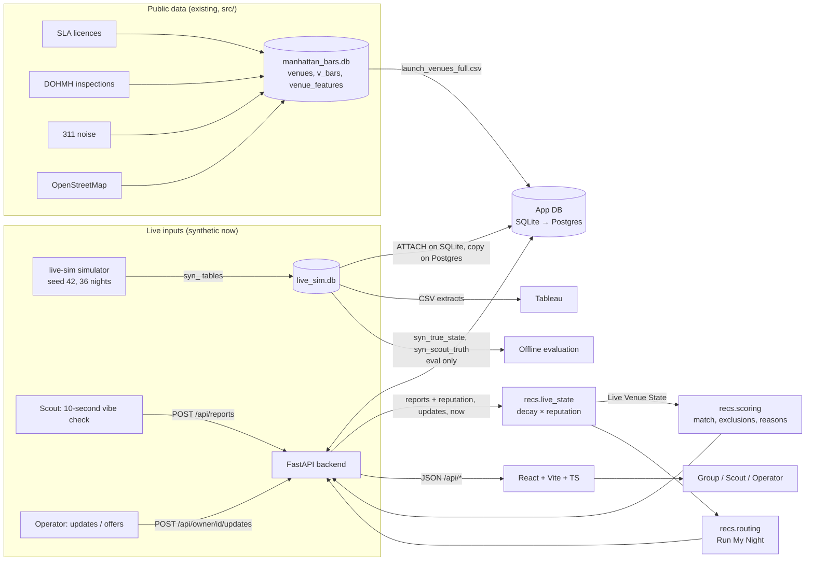
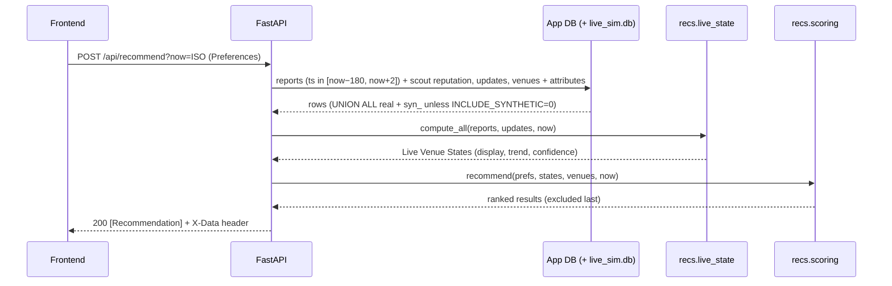

# Architecture — Nightlife Autopilot

Purpose: components, data flow, environments and stack that every workstream builds against.
Status: agreed (follows Contracts v2–v2.2 + §J; contracts win on conflict).
Last updated: 2026-11-17

## 1. System diagram

## 2. Components
| Component | Owner | Folder | Responsibility |
|---|---|---|---|
| Public-data pipeline | existing | `src/`, `data/manhattan_bars.db` | venues, licences, inspections, 311, OSM; read-only |
| Specs | specs | `docs/specs/` | formulas, parameters, golden vectors, requirements, trust, metrics |
| Simulator | live-sim | `simulator/`, `data/synthetic_live/` | all `syn_` tables, Thu–Sat Aug 27 → Nov 14 2026, `python -I -m simulator --seed 42 --out data/live_sim.db` |
| `recs` package | ml-recs | `recs/` | `live_state.compute[_all]`, `scoring.recommend`, `routing.plan_night`, crowd model, clustering |
| Backend API | backend | `backend/` | endpoints (Contracts + v2 §G), demo-login auth, write-time trust rules ([scout-trust.md](scout-trust.md)), points ledger |
| Frontend | frontend | `frontend/` | screens, mock-API mode, "demo data" badge, MapLibre map |
| Analytics | tableau | `analytics/tableau/` | extracts, dashboard |
| Research | research | `research/` | competitors, interview guide, synthetic interviews |
| Integration | integration | `tests/e2e/`, `scripts/`, `Makefile`, `.github/`, root docs | merge order, deploy, demo |

## 3. Request sequence (`POST /api/recommend`)

## 4. Data rules
- Live state is computed per request, never stored as truth. A 60 s in-memory cache keyed by
  `now` rounded to the minute is allowed.
- `venue_id` = SLA `license_id`; `data/launch_venues.csv` keeps header `license_id` (alias on load).
- Synthetic tables live in `data/live_sim.db` (generated at build time, not committed). Real twin
  tables (`scout_reports`, `venue_updates`, `venue_events`, `feedback`, `bounties`, `disputes`,
  `points_ledger`) exist empty from day one; backend reads `UNION ALL`. `INCLUDE_SYNTHETIC=0`
  hides synthetic rows — this is the swap-to-real path.
- `data/venue_attributes_manual.csv` (`is_synthetic=0`) overrides `syn_venue_attributes` rows.
- Evaluation-only tables (`syn_true_state`, `syn_scout_truth`) are never read by the app or API.
- Complaint risk is shown as "311 noise-complaint risk", never as quality.
- No raw GPS stored; only `distance_m`. Display names only.

## 5. `now=` replay
- Read endpoints accept `now=<ISO>`; default is env `DEMO_NOW` if set, else wall clock.
- Demo moment: `DEMO_NOW = 2026-11-14T23:30:00-05:00`. Frontend forwards `VITE_DEMO_NOW` / URL `?now=`.
- Reads only consider inputs with `ts ≤ now + 2 min`, so replay never sees the future.

## 6. Environments
| Env | Backend | DB | Frontend | Data |
|---|---|---|---|---|
| local | `uvicorn` :8000 | SQLite + attached `data/live_sim.db` | `vite` :5173 or `VITE_API_MODE=mock` | `make data` (seed 42) |
| preview | Render web service (optional) | SQLite on disk (ephemeral) | Vercel preview | built at deploy |
| demo | Render web service | Render Postgres, or SQLite fallback | Vercel production | built at deploy; `DEMO_NOW` set |

No Render/Vercel accounts exist yet (Nov 17): configs (`backend/render.yaml`, Vercel project
settings) and deploy steps are prepared but nothing is deployed. Deploy steps when accounts exist:
1. Render → New Blueprint → repo → `render.yaml`; build runs `pip install -r backend/requirements.txt && python -I -m simulator --seed 42 --out data/live_sim.db`.
2. Set `DEMO_NOW`, `CORS_ORIGINS` (Vercel URL), `INCLUDE_SYNTHETIC=1`, optional `DATABASE_URL`.
3. Vercel → import `frontend/`, set `VITE_API_BASE` (Render URL), `VITE_API_MODE=live`, `VITE_DEMO_NOW`.
4. Warm-up ping `/api/health` 2 min before the demo (free tier sleeps).

## 7. Env vars (Contracts v2 §H)
| Var | Side | Meaning |
|---|---|---|
| `INCLUDE_SYNTHETIC` | backend | 1 (default) include `syn_` rows; 0 real only |
| `DEMO_NOW` | backend | default `now` for reads |
| `CORS_ORIGINS` | backend | comma-separated origins |
| `DATABASE_URL` | backend | Postgres URL; unset → SQLite |
| `LIVE_SIM_DB` | backend | path to `live_sim.db` |
| `FEATURE_ROUTING`, `FEATURE_HEATMAP` | backend | enable Later endpoints |
| `VITE_API_BASE`, `VITE_API_MODE` | frontend | API URL; `mock` or `live` |
| `VITE_DEMO_NOW` | frontend | forwarded as `now=` |
| `VITE_FEATURE_ROUTING`, `VITE_FEATURE_HEATMAP` | frontend | show Later screens |

## 8. Stack and rationale
FastAPI ≥ 0.115 + Pydantic 2 + SQLAlchemy 2, Python 3.12; SQLite now, Postgres 16 later (one
connection string). React 18 + Vite 5 + TypeScript 5 on Node 20 LTS. MapLibre GL with a free
no-key style (OpenFreeMap or CARTO dark-matter). Render (API) + Vercel (web) free tiers.
Why: one language for pipeline, `recs` and API; SQLite needs no account; all hosts deploy on git
push. Exact pins are backend/frontend's call (see their `docs/workstreams/*.md`).

## 9. Error and data-labelling conventions
- Errors: `{"error": {"code", "message", "details"}}` (422s reshaped).
- Every response object has `is_synthetic`; list endpoints set `X-Data: synthetic|real|mixed`.
- UI shows a "demo data" badge wherever synthetic data appears.
