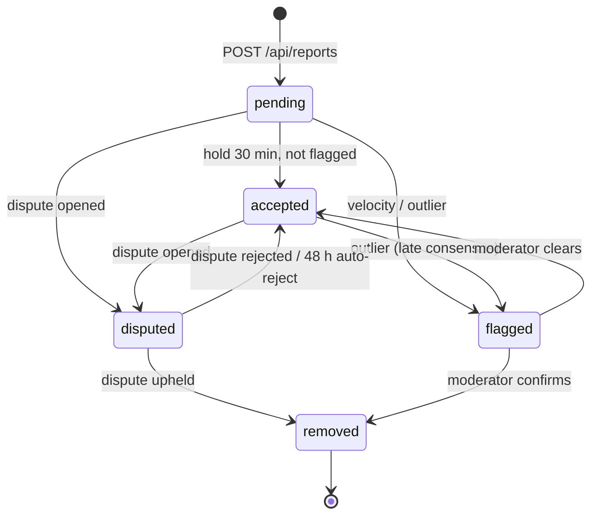

# Scout trust — reputation, anti-gaming, disputes, bounties, points

Purpose: write-time trust rules for backend and the gaming behaviours live-sim must simulate.
Status: agreed (constants are placeholders in [PARAMETERS.md](PARAMETERS.md)).
Last updated: 2026-11-17

## 1. Reputation
```
new scout: r = rep_new_scout (0.5); while reports_count < new_scout_reports, weight uses 0.5
consensus for report i = ≥ consensus_min_others accepted reports from OTHER scouts,
                         same venue, |ts − ts_i| ≤ consensus_window_min
consensus_crowd = weighted mean crowd of those reports (SCORING §2 weights at ts_i)
a = 1 − |crowd_i − consensus_crowd| / 4
r ← clip(r + rep_lr · (a − rep_target_agreement), rep_min, rep_max)
verified_presence on report i: r += rep_verified_bonus (then clip)
dispute upheld against report i: r += rep_dispute_upheld (−0.10), then clip
no consensus → r unchanged
```
Reputation is updated when a report leaves `pending` (after `points_hold_min`). The app reads
current `scouts.reputation`; replays and models read `syn_scout_reputation_history` as of the
report date. Reputation (not level) drives weight; `w_rep ≤ 1` caps any one scout.

## 2. Anti-gaming checks
| # | Check | Layer | Result |
|---|---|---|---|
| 1 | Rate limits: 1 report / venue / scout / `rate_venue_window_min`; ≤ `rate_hour_max` per hour | backend (write) | 429 `{"error":{"code":"rate_limited","message":"You already checked this venue — try again in N min"}}` |
| 2 | Owner of venue reports own venue | backend (write) | 403 `owner_own_venue` |
| 3 | Presence: GPS within `presence_radius_m` (150 m) | backend (write) | `verified_presence=1`, store `distance_m` only |
| 4 | Velocity: two reports by a scout imply > `velocity_kmh_max` between venues | backend (write) | later report `flagged` |
| 5 | Outlier: ≥ `outlier_min_others` other reports in ±`consensus_window_min` and \|crowd − consensus\| ≥ `outlier_crowd_gap` | backend (write) or recs (read) | `flagged` (weight 0) |
| 6 | New scouts (< `new_scout_reports`) fixed at r = 0.5 | backend join | no volume-bought reputation |
| 7 | Bounty farming: bounty pays only if verified and not flagged after hold | backend | no payout |
| 8 | Operators never supply crowd/dancing/line | recs | ignored fields |

live-sim archetypes in `syn_scout_truth` (eval only, never read by the app):
`honest` (truth ± small noise), `casual` (sparse, noisier), `sloppy` (large noise, rarely verified),
`gamer` (always crowd 5, many venues, often unverified, may trip velocity), `shill` (inflates one
`home_venue_id`). Evaluation measures how much checks 4–6 protect crowd MAE (pilot-metrics §3).

## 3. Report status machine

Weights: pending/accepted 1.0, disputed `w_disputed` (0.5), flagged/removed 0 (SCORING §1).

## 4. Disputes
- Opened by the venue owner (or a user) on a report with a required `reason`; row in `syn_disputes`/`disputes`.
- Moderator (team member via script/admin endpoint in MVP) resolves: upheld → report `removed`,
  scout `r += rep_dispute_upheld`, points clawed back + `pts_clawback_penalty`; rejected → `accepted`.
- Disputes open longer than `dispute_autoreject_h` (48 h) auto-reject.

## 5. Points and levels
| Event | Points |
|---|---|
| report accepted (after hold) | `pts_accepted` (+10) |
| verified presence | `pts_verified` (+5) |
| first report at the venue tonight (after 20:00) | `pts_first_tonight` (+5) |
| bounty claimed | `bounty.points` |
| report flagged / dispute upheld | clawback of that report's points, plus `pts_clawback_penalty` (−10) |

Points are "pending" until the hold ends, then "earned"; every change is a row in
`points_ledger` (`entry_id, scout_id, report_id, bounty_id, points, reason, ts`).
Levels (all-time earned points): Rookie 0, Regular `level_regular` (100), Insider `level_insider` (500),
Legend `level_legend` (1500). Levels are cosmetic. Leaderboard shows a reputation **band**
(low < 0.4, ok 0.4–0.7, high > 0.7), not the raw number.

## 6. Bounties
```
every 15 min, 21:00–02:00, Thu–Sat, for each launch venue with confidence < bounty_conf_max
  and no open bounty, while open bounties < bounty_max_open:
    points = bounty_base_pts + bounty_step_pts · min(3, floor(freshness_minutes / 30))
             (freshness null → bounty_null_fresh_pts)
    reason = "conflicting reports" if agree < bounty_agree_conflict else "no fresh reports"
    expires_at = created_at + bounty_ttl_min
claimed implicitly by the first verified, not-flagged report before expiry (claimed_by, claimed_at);
pays after the hold. No claim endpoint in MVP.
```

## 7. Privacy
Store `distance_m`, never raw lat/lon of the scout. Public surfaces show display name, level,
reputation band. No contact data.
